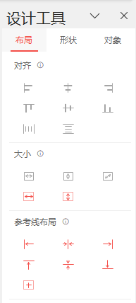
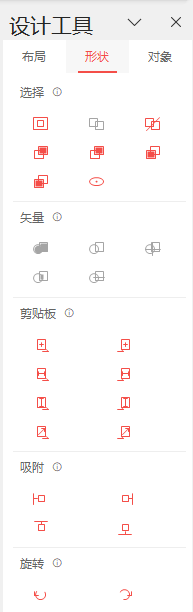

# Lean Design Tools

一款专为 Windows 版 PowerPoint 打造的**轻量级排版与设计辅助侧边栏插件**。

如果你经常在制作 PPT 时被“反复对齐图形、逐个调文本框边距、跨页复制位置大小”等繁琐操作消耗时间，**Lean Design Tools** 可以把这些高频排版功能集中到一个常驻右侧的任务窗格中——**无需层层翻找菜单，所见即所得，点一下就能完成排版**。

## 🖼️ 界面预览

| 布局 | 形状 | 对象 |
| :---: | :---: | :---: |
|  |  |  |

---

## ✨ 为什么选择它？

- **界面直白、零学习成本**：参考经典设计插件的交互习惯打造，分为**「布局」「形状」「对象」**三大功能页签。所有工具按钮默认完全展开，没有多余的折叠动画，鼠标悬停在任意按钮上（包括灰色暂不可用状态）都会显示清晰的功能与操作提示。
- **纯净轻量、独立运行**：零广告、无捆绑、不联网加载臃肿资源，启动秒开，专注于本地高效排版。
- **完全开源免费**：基于 MIT 协议开源，界面与图标均由底层独立重绘实现，不包含任何第三方商业插件的代码或受版权保护的素材。

---

## 🚀 快速上手（3 步安装）

### 第 1 步：确认电脑环境

- **操作系统**：Windows（64 位）
- **PowerPoint 版本**：**64 位**桌面版 Office（已在 64 位 PowerPoint LTSC 2024 实测通过；暂不支持 32 位 Office 及 macOS）
- **运行组件**：需具备 `.NET Framework 4.8`（Windows 10/11 通常已自带，安装程序也会自动检测）

### 第 2 步：下载并安装

1. 前往本仓库右侧的 **[Releases](../../releases)** 页面，下载最新安装包：`LeanDesignTools-Setup-x64-版本号.exe`。
2. **保存并关闭所有正在运行的 PowerPoint 窗口**（重要，否则插件无法完成注册）。
3. 双击运行安装程序，按提示完成安装即可。

### 第 3 步：在 PowerPoint 中打开使用

1. 重新打开任意 PPT 文件。
2. 在顶部功能区找到 **Lean Design Tools** 选项卡并点击展开右侧任务窗格（建议将其停靠在屏幕右侧，随时随地顺手调用）。

> 💡 **如何卸载？**  
> 本插件已接入 Windows 标准卸载入口，随时可在「Windows 设置 → 应用 → 已安装的应用」中找到 **Lean Design Tools** 一键卸载。

---

## 📖 功能使用手册

任务窗格按日常做 PPT 的操作习惯分为 **布局**、**形状**、**对象** 三个核心区域：

### 1. 布局：告别手动拖拽，一秒对齐元素

选中多个形状、图片或文本框后，可一键完成：

- **精准对齐与分布**：左/中/右对齐、顶/垂直居中/底对齐，以及横向/纵向等距分布。
- **批量统一尺寸**：一键将多个对象设为**等宽、等高或完全等大**。
- **页面级快速定位**：让对象一键**贴合幻灯片边缘、页面居中或铺满整页**。
- **智能微调与变换**：支持四向吸附贴靠，以及快速旋转和水平/垂直翻转。

### 2. 形状：高效管理图层与组合图形

- **图层与选择管理**：提供全选、组合、取消组合、调整图层前后顺序，以及快速呼出 PowerPoint「选择窗格」。
- **布尔运算（合并形状）**：支持对多个形状进行**联合、组合、拆分、相交、剪除**，轻松绘制自定义矢量图形。

### 3. 对象：尺寸精调、跨页格式刷与文本框神器

这是提升排版效率的核心区域，所有数值均采用直观的**厘米（cm）**单位：

- **厘米级尺寸精确控制**（图片与普通形状通用）
  - 选中任意对象后，输入框会**自动显示当前对象的实际宽度和高度**；直接输入新数值即可精准调整尺寸。
- **跨幻灯片“位置/大小”复制粘贴（四重独立记忆）**
  - 想把第 2 页 Logo 的位置和大小原封不动套用到第 10 页？只需点击复制位置/宽度/高度/大小，切换到目标页面粘贴即可。
  - **贴心设计**：位置、宽度、高度、大小四类剪贴板**各自独立、互不覆盖**，可放心组合使用。
- **文本框深度排版工具**
  - **智能拆分与合并**：支持将一整段文字**按单字拆分成独立文本框**、**按段落拆分成多个文本框**，也支持将多个文本框重新合并。
  - **状态自动同步与边距微调**：选中文本框时，面板会自动读取并显示当前的**文本框自适应模式、自动换行状态以及上/下/左/右四边距（cm）**；搭配直观的边界箭头指示，修改内边距无需再右键打开繁琐的“设置形状格式”侧栏。
  - **一键清空文本**：保留文本框样式与位置，一键清空内部文字。

---

## ❓ 常见问题（FAQ）

**Q：为什么面板上有一些按钮是灰色的，点不了？**  
A：这是正常的上下文防误触保护（例如只选中 1 个图形时，“等距分布”或“合并形状”会自动置灰）。你可以直接把鼠标悬停在灰色按钮上，悬浮提示会告诉你当前需要选中什么对象才能激活该功能。

**Q：支持 WPS 或 32 位 Office 吗？**  
A：目前仅针对 **64 位 Microsoft PowerPoint** 构建与测试，暂不支持 32 位 Office 或 WPS。

---

## 🛠️ 开发者与源码构建说明

如果你希望从源码编译或参与开发调试，请参考以下脚本（均需在保存并关闭 PowerPoint 后执行）：

| 操作 | 命令 | 说明 |
| :--- | :--- | :--- |
| **编译项目** | `.\build.ps1` | 依赖本机安装的 64 位 Office 与 Extensibility PIA |
| **本地安装调试** | `.\install.ps1` | 需**管理员权限**，调用 64 位 `.NET Framework RegAsm` 注册 COM 类并写入当前用户加载项 |
| **本地卸载清理** | `.\uninstall.ps1` | 移除本地注册的 COM 组件与加载项配置 |
| **打包安装程序** | `.\build-installer.ps1` | 需提前安装 **Inno Setup 6**，产物输出至 `dist\LeanDesignTools-Setup-x64-版本号.exe` |

- **测试与验证报告**：完整的自动化测试与真实 PowerPoint 环境验证记录请查阅 [VERIFICATION.md](./VERIFICATION.md)。
- **开源协议**：[MIT License](./LICENSE)
